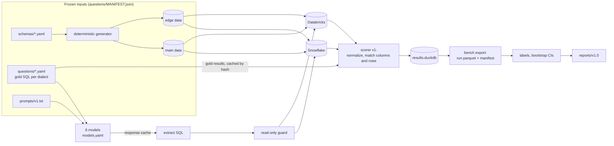

# Warehouse SQL Bench

Warehouse SQL Bench measures how accurately LLMs turn natural-language
questions into SQL on **Snowflake** and on **Databricks**.

It is a controlled comparison. The same questions run on the same synthetic
data, loaded into both warehouses, so the SQL dialect is the main thing that
changes. Every prediction is scored by executing it: it counts as correct
only if its result matches the gold result on a realistic dataset (main)
**and** on a small adversarial one (edge). The report leads with why models
fail, by warehouse and by failure type, and gives accuracy with confidence
intervals.

**Full report: [reports/v1.0/README.md](reports/v1.0/README.md)**, generated
by `bench report` from [results/run-v1.0.1-full.parquet](results/run-v1.0.1-full.parquet).

## Headline findings (v1.0)

Copied from the generated report; 72 questions, 6 models, 864 scored tasks.

- **Databricks failures are mostly SQL that never compiled.** Databricks
  has 55 syntax errors against 20 on Snowflake. Only 2 failures leak the
  other warehouse's dialect (Snowflake `LATERAL FLATTEN` on Databricks).
  Functions that exist on neither warehouse (SQLite's STRFTIME, JULIANDAY,
  GROUP_CONCAT) account for 23 failures on Snowflake and 26 on Databricks.
- **The top models can't be separated, and neither can the warehouses.**
  No model's Snowflake-vs-Databricks difference is significant at 95%.
  Among the top four models, no difference between neighbours in the
  ranking is significant either.
- **The edge dataset caught 8 answers** that were right on the realistic
  data and wrong on the adversarial data. All 8 came from the two weaker
  models: scoring on main alone would have overstated each by 2.8 pp.
- **The read-only guard blocked 1 valid query.** It was Databricks
  `MAX RECURSION LEVEL`, which sqlglot can't parse; EXPLAIN on Databricks
  accepted it. It is scored as a syntax error.

## Leaderboard

Correct on main and edge, with 95% bootstrap intervals over questions.

| model | snowflake | databricks |
|---|---|---|
| claude-opus-5-5 | 98.6% [95.8, 100.0] | 100.0% [100.0, 100.0] |
| gpt-6-astra | 100.0% [100.0, 100.0] | 97.2% [93.1, 100.0] |
| gemini-4-carbon | 100.0% [100.0, 100.0] | 95.8% [90.3, 100.0] |
| deepseek-v4-pro-0813 | 94.4% [88.9, 98.6] | 87.5% [79.2, 94.4] |
| qwen3-coder | 73.6% [63.9, 83.3] | 73.6% [63.9, 83.3] |
| arctic-text2sql-r1-7b | 33.3% [22.2, 44.4] | 34.7% [23.6, 45.8] |

The ordering of the top four isn't meaningful: see the report's paired
comparisons.

## How it works



- **Data:** each schema is generated twice from a fixed seed: main
  (realistic) and edge (small, with NULLs, duplicates, ties, empty groups,
  boundary dates, missing JSON keys and messy strings). Both warehouses
  load the same Parquet files.
- **Questions:** each has gold SQL for both dialects. Both golds must
  return the same normalized result on both datasets before a question can
  be verified. `portable` questions use one SQL text for both warehouses.
  `dialect_sensitive` ones differ by `syntax` (same capability, different
  spelling) or by `semantics` (SQL that looks portable but returns
  different results by default; each trap was confirmed on both
  warehouses).
- **Scoring:** execution only. Values are normalized (numbers across
  types, timestamps in UTC, JSON canonicalized, NULL equal only to NULL),
  columns may be in any order, rows are compared as multisets unless order
  matters. See [docs/scoring.md](docs/scoring.md).
- **Reproducibility:** every result row carries the git sha, prompt hash,
  question-set hash, data hash and scorer version.

## Quickstart

Needs Python 3.11+ and [uv](https://docs.astral.sh/uv/).

```bash
git clone https://github.com/ajitsxro/warehouse-sql-bench && cd warehouse-sql-bench
uv sync

# 1. Generate both datasets (deterministic; hashes are checked against manifests/)
uv run bench data generate --all --profile main
uv run bench data generate --all --profile edge

# 2. Free dry run on local DuckDB: transpiled gold SQL and a model that answers with gold
uv run bench data load --warehouse duckdb --all --profile main --yes
uv run bench data load --warehouse duckdb --all --profile edge --yes
uv run bench run --dry-run   # 122 of 144 tasks run; 22 golds use features DuckDB lacks

# 3. Real warehouses and models: fill in .env from .env.example, then
uv run bench ping -w snowflake && uv run bench ping -w databricks
uv run bench data load --warehouse snowflake --all --profile main   # prints a cost estimate first
uv run bench run --run-id my-run                                    # prints a cost estimate, waits for yes
uv run bench export --run-id my-run
uv run bench report --run my-run --version my-report
```

`bench run` resumes by `--run-id`: provider errors aren't stored, so
running the same command again retries only what's missing.

## Cost to reproduce

- **Models:** $8.57 at list prices for all 864 answers
  (`cost_usd_at_list_price` in
  [the run manifest](results/run-v1.0.1-full.manifest.json)); $6.61 of it
  is gpt-6-astra, claude-opus-5-5 and gemini-4-carbon. Arctic runs locally
  on Ollama for $0.
- **Warehouses:** the run's cost gate gives an upper bound of about 2.8
  Snowflake credits on an X-Small warehouse and 11.3 DBU on a 2X-Small
  Databricks SQL warehouse, assuming every query runs to its timeout. The
  real runs used trial credits and Databricks Free Edition, so actual
  warehouse spend wasn't measured.

## Related work

This is not the first warehouse text-to-SQL benchmark.

- **Spider 2.0** (Lei et al., ICLR 2025) evaluates enterprise text-to-SQL
  on real databases. Spider 2.0-Snow has 547 examples on Snowflake;
  Spider 2.0-Lite has 547 on BigQuery, Snowflake and SQLite; Spider 2.0-DBT
  has 68 code-agent tasks on DuckDB. The text-to-SQL settings use execution
  accuracy, and a prediction counts as correct if every gold column appears
  in its result (extra columns allowed). Spider 2.0 has no Databricks
  subset, and its tasks differ between databases, so it doesn't compare one
  question across warehouses.
- **BIRD** (Li et al., NeurIPS 2023) has 12,751 question-SQL pairs over 95
  databases (33.4 GB) in 37 domains, scored by execution accuracy, with an
  efficiency score (now R-VES). Its Mini-Dev set is available in SQLite,
  MySQL and PostgreSQL.

What this benchmark adds is narrow: the same questions on the same data in
Snowflake and Databricks, with semantics traps confirmed on both, and a
second adversarial dataset that every answer must also pass. It is much
smaller than either benchmark above.

## Limitations

- **Small.** v1.0 has 72 questions on 2 schemas (ecommerce, hr_people).
  The plan is about 180 questions on 6 schemas; the other four schemas
  are defined in `schemas/` but have no questions yet. With 72 questions the top models'
  intervals overlap.
- **Synthetic data.** The data is generated, not real. Some relationships
  aren't modelled; the schema descriptions say which, and questions avoid
  them.
- **Zero-shot, one prompt.** Each model got one prompt template
  ([prompts/v1.txt](prompts/v1.txt)) with the DDL and 3 sample rows per
  table, and one answer per question. No retries, no agents, no execution
  feedback. A one-character wording fix flipped 2 answers in our runs, so
  single-sample results are noisy.
- **Model versions and dates.** The answers were generated from 2026-11-10
  to 2026-11-12. claude-opus-5-5 and gpt-6-astra ran at their default
  temperature (their APIs reject 0); the others at 0. OpenRouter served
  deepseek-v4-pro-0813 and qwen3-coder from several upstream hosts; each
  row records which. Arctic-Text2SQL-R1-7B ran locally as an 8-bit GGUF
  build, not the original weights.
- **Labels.** The 80 root-cause labels in the report were made by an LLM
  agent, not a person. The scorer audit (40 items) was also LLM-labelled.
- **Error categories differ by warehouse.** Snowflake reports an unknown
  function as a runtime error and Databricks as a syntax error, so those
  two counts aren't comparable across warehouses. Accuracy is unaffected.

## Repository

- `src/sqlbench/`: generator, loaders, warehouse adapters, scorer, model
  clients, harness, analysis.
- `schemas/`, `questions/`, `prompts/`, `models.yaml`: the inputs.
- `results/`: exported runs, labels, guard checks. `reports/`: generated
  reports.
- [docs/dataset_card.md](docs/dataset_card.md),
  [docs/scoring.md](docs/scoring.md),
  [docs/semantics_probes.md](docs/semantics_probes.md),
  [CONTRIBUTING.md](CONTRIBUTING.md), [CHANGELOG.md](CHANGELOG.md).

## License

Code: MIT ([LICENSE](LICENSE)). Questions and gold SQL: CC BY 4.0
([questions/LICENSE](questions/LICENSE)).
