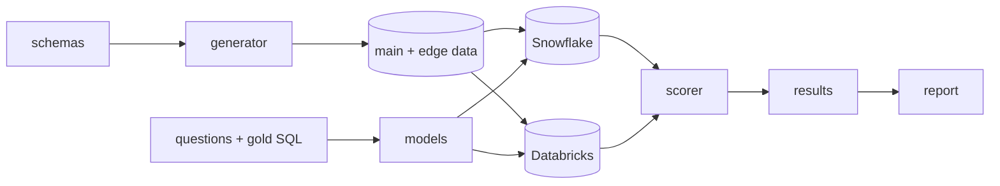

# Warehouse SQL Bench

How well do LLMs write SQL for Snowflake versus Databricks?

This benchmark asks both warehouses the same questions over the same
synthetic data, so the dialect is the main variable. Predictions are
scored by running them. An answer only counts if it matches gold on the
realistic dataset and on a small adversarial one (NULLs, ties, duplicates,
empty groups, messy strings).

Full results: [reports/v1.0](reports/v1.0/README.md)

## Results (v1.0)

72 questions, 6 models, both warehouses. Correct on both datasets, with
95% bootstrap intervals over questions:

| model | snowflake | databricks |
|---|---|---|
| claude-opus-5-5 | 98.6% [95.8, 100.0] | 100.0% [100.0, 100.0] |
| gpt-6-astra | 100.0% [100.0, 100.0] | 97.2% [93.1, 100.0] |
| gemini-4-carbon | 100.0% [100.0, 100.0] | 95.8% [90.3, 100.0] |
| deepseek-v4-pro-0813 | 94.4% [88.9, 98.6] | 87.5% [79.2, 94.4] |
| qwen3-coder | 73.6% [63.9, 83.3] | 73.6% [63.9, 83.3] |
| arctic-text2sql-r1-7b | 33.3% [22.2, 44.4] | 34.7% [23.6, 45.8] |

What stood out:

- Databricks had 55 syntax errors to Snowflake's 20. Few were Snowflake
  syntax leaking over (2 cases of `LATERAL FLATTEN`). Most were functions
  neither warehouse has, like SQLite's STRFTIME (23 on Snowflake, 26 on
  Databricks), almost all from the 7B model.
- No model's Snowflake vs Databricks gap is significant, and the top four
  models can't be ranked against each other at this size.
- The adversarial dataset caught 8 answers that were only right on the
  realistic data, all from the two weakest models.
- The read-only guard rejected one valid Databricks query
  (`MAX RECURSION LEVEL`, which sqlglot can't parse). It counts as a
  syntax error.

## How it works



Each question has gold SQL for both dialects, and both golds must agree on
both datasets before the question is used. Some questions are traps: SQL
that looks portable but returns different results on each warehouse (NULL
ordering, DATEDIFF boundaries, GREATEST with NULLs). Each trap was checked
on both warehouses first. Scoring rules are in
[docs/scoring.md](docs/scoring.md). Every result row records the commit,
prompt, question set, data and scorer version it came from.

## Running it

Needs Python 3.11+ and [uv](https://docs.astral.sh/uv/).

```bash
uv sync
uv run bench data generate --all --profile main
uv run bench data generate --all --profile edge

# free local run on DuckDB, with a fake model that answers with gold
uv run bench data load --warehouse duckdb --all --profile main --yes
uv run bench data load --warehouse duckdb --all --profile edge --yes
uv run bench run --dry-run

# real warehouses and models: copy .env.example to .env and fill it in
uv run bench data load --warehouse snowflake --all --profile main
uv run bench run --run-id my-run
uv run bench export --run-id my-run
uv run bench report --run my-run --version my-report
```

The dry run scores 122 of 144 tasks. The other 22 use warehouse features
DuckDB doesn't have. Paid commands print a cost estimate and wait for
confirmation. A run can be resumed with the same `--run-id`.

Reproducing v1.0 costs about $8.57 in model calls at list price. Warehouse
use was on trial credits and wasn't metered.

## Limitations

- 72 questions on 2 schemas. Four more schemas are defined but have no
  questions yet.
- Synthetic data, zero-shot, one prompt, one sample per question. A
  one-character wording fix flipped 2 answers, so small differences are
  noise.
- Answers were generated 2026-11-10 to 2026-11-12. Claude and GPT ran at
  default temperature (their APIs reject 0), the rest at 0. OpenRouter
  models were served by several hosts. Arctic ran locally as an 8-bit GGUF.
- The failure root-cause labels and the scorer audit were done by an LLM,
  not a person.
- Snowflake reports an unknown function as a runtime error and Databricks
  as a syntax error, so those counts don't compare directly.

## Related work

[Spider 2.0](https://spider2-sql.github.io/) (ICLR 2025) evaluates
text-to-SQL on Snowflake, BigQuery and SQLite with execution accuracy, but
its tasks differ per database and it has no Databricks set.
[BIRD](https://bird-bench.github.io/) (NeurIPS 2023) has 12,751 questions
over 95 databases, with a dev subset in SQLite, MySQL and PostgreSQL. Both
are much larger than this. The difference here is the same questions on the
same data in two warehouses.

## License

Code is MIT. Questions and gold SQL are CC BY 4.0. See
[CONTRIBUTING.md](CONTRIBUTING.md) to add a model or question, and
[docs/dataset_card.md](docs/dataset_card.md) for how the data and
questions were built.
