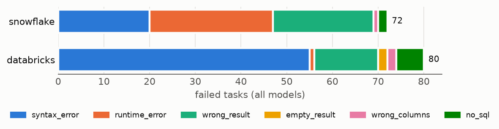
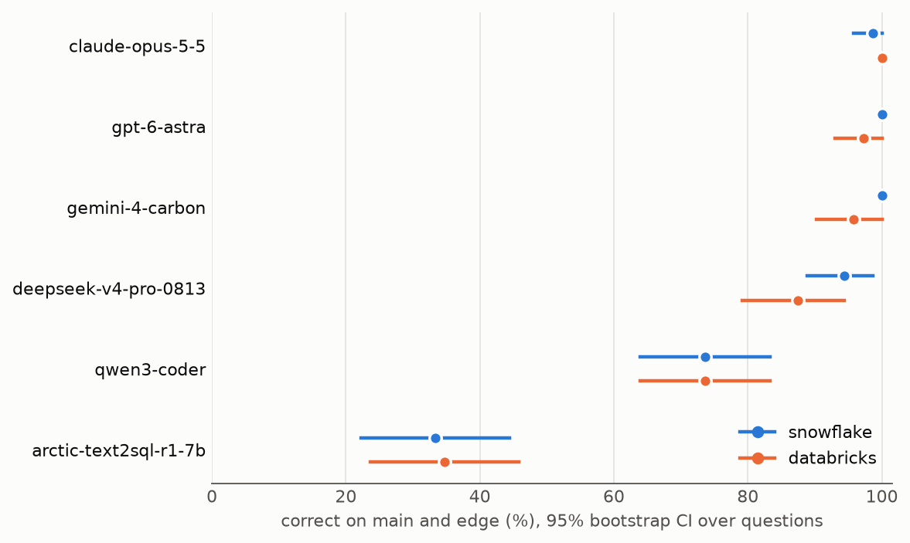
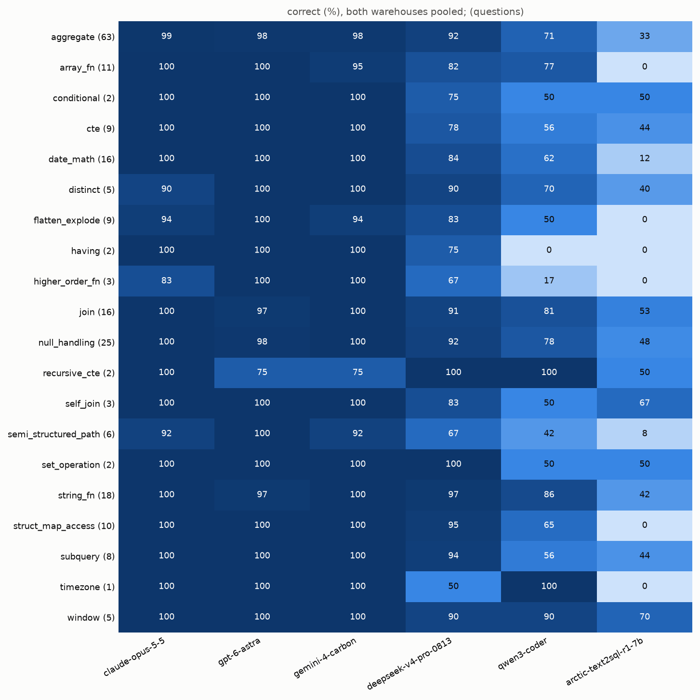

# Warehouse SQL Bench v1.0.1-full: results

Generated by `bench report` from `results/run-v1.0.1-full.parquet`. Every number below comes from code.

|  |  |
|---|---|
| questions | 72 |
| models | 6 |
| warehouses | snowflake, databricks |
| scored tasks | 864 |
| run | 2026-11-12T22:31:51.814319 to 2026-11-12T22:33:46.012898 UTC |
| git sha | 95af4dafa54f7ab0e1fc2c0f7705d829d1845080 |
| question set sha256 | a7bfe72a247289c9fc468e894800da93ee754b0c3185637446342c893593e1f5 |
| data sha256 | 82a689091dae66d0411c0283e543416c68665d0f8696e56aa6a06d972df3b1b3 |
| scorer version | 1 |
| results file sha256 | 8e944bc22e39f2fb39d2d17f9cfcc791e3a9252899e7afd0a74b09c5828a99c2 |

A task is correct only if its result matches gold on both the main and the edge dataset.

## 1. Why predictions fail



### By outcome

| outcome | snowflake | databricks |
|---|---|---|
| empty_result | 0 | 2 |
| no_sql | 2 | 6 |
| runtime_error | 27 | 1 |
| syntax_error | 20 | 55 |
| wrong_columns | 1 | 2 |
| wrong_result | 22 | 14 |
| **all failures** | 72 | 80 |

### By automatic label

A failure can carry several labels or none. Definitions are in `src/sqlbench/analysis/labels.py`.

| label | snowflake | databricks |
|---|---|---|
| dialect_leak | 0 | 2 |
| unknown_function | 23 | 26 |
| schema_hallucination | 0 | 1 |
| semantics_trap | 5 | 2 |
| lucky_match | 6 | 2 |

### By divergence type

| divergence | warehouse | tasks | failed | failure rate | most common outcomes |
|---|---|---|---|---|---|
| none | snowflake | 216 | 23 | 10.6% | wrong_result 10, runtime_error 9, syntax_error 4 |
| none | databricks | 216 | 26 | 12.0% | syntax_error 15, wrong_result 7, no_sql 2 |
| syntax | snowflake | 144 | 34 | 23.6% | syntax_error 16, runtime_error 11, wrong_result 6 |
| syntax | databricks | 144 | 40 | 27.8% | syntax_error 31, no_sql 3, wrong_result 3 |
| semantics | snowflake | 72 | 15 | 20.8% | runtime_error 7, wrong_result 6, no_sql 1 |
| semantics | databricks | 72 | 14 | 19.4% | syntax_error 9, wrong_result 4, no_sql 1 |

## 2. Example failures

One failure per category, picked by a hash of the task, preferring a model not shown yet. Predicted result rows aren't stored, so each example shows the outcome on each dataset and the warehouse's error.

### Dialect leak: ecommerce_026, qwen3-coder on databricks

> How many orders placed in 2024 (UTC) have a cart total above 500, where the cart total is the sum of qty times unit_price over the lines of attributes.items?

main: syntax_error; edge: syntax_error; labels: dialect_leak

Error: `` [PARSE_SYNTAX_ERROR] Syntax error at or near 'FLATTEN': missing 'VIEW'. SQLSTATE: 42601 (line 7, pos 10) ``

Predicted:

```sql
SELECT COUNT(*) AS high_value_orders_count
FROM (
  SELECT 
    o.order_id,
    SUM(item.qty * item.unit_price) AS cart_total
  FROM orders o
  LATERAL FLATTEN(input => o.attributes:items) AS item
  WHERE YEAR(o.placed_at) = 2024
  GROUP BY o.order_id
  HAVING cart_total > 500
)
```

Gold:

```sql
SELECT COUNT(*) AS orders
FROM (
    SELECT o.order_id
    FROM orders AS o,
         LATERAL variant_explode(o.attributes:items) AS f
    WHERE o.placed_at >= TIMESTAMP '2024-01-01 00:00:00'
  AND o.placed_at < TIMESTAMP '2025-01-01 00:00:00'
    GROUP BY o.order_id
    HAVING SUM(f.value:qty::INT * f.value:unit_price::DECIMAL(10,2)) > 500
) AS large_carts
```

### Function from neither warehouse: ecommerce_023, arctic-text2sql-r1-7b on snowflake

> What was the item revenue (quantity times unit_price minus discount_amount, a missing discount meaning none) in each month of 2024 (UTC)? Label months as 'YYYY-MM', for example '2024-03'.

main: runtime_error; edge: runtime_error; labels: unknown_function

Error: `` 002139 (02000): SQL compilation error: Unknown functions STRFTIME, STRFTIME. ``

Predicted:

```sql
SELECT 
  strftime('%Y-%m', o.placed_at) AS month,
  SUM(oi.quantity * oi.unit_price - COALESCE(oi.discount_amount, 0)) AS item_revenue
FROM 
  orders o
INNER JOIN 
  order_items oi ON o.order_id = oi.order_id
WHERE 
  o.placed_at >= '2024-01-01' AND o.placed_at < '2025-01-01'
GROUP BY 
  strftime('%Y-%m', o.placed_at)
ORDER BY 
  month
```

Gold:

```sql
SELECT TO_CHAR(o.placed_at, 'YYYY-MM') AS month, SUM(oi.quantity * oi.unit_price - COALESCE(oi.discount_amount, 0)) AS revenue
FROM orders AS o
JOIN order_items AS oi ON oi.order_id = o.order_id
WHERE o.placed_at >= TIMESTAMP '2024-01-01 00:00:00'
  AND o.placed_at < TIMESTAMP '2025-01-01 00:00:00'
GROUP BY TO_CHAR(o.placed_at, 'YYYY-MM')
```

### Invented table or column: ecommerce_019, arctic-text2sql-r1-7b on databricks

> How many products carry each tag? Return the tag and the number of products; a product that lists the same tag twice counts once.

main: syntax_error; edge: syntax_error; labels: schema_hallucination

Error: `` [TABLE_OR_VIEW_NOT_FOUND] The table or view `tags` cannot be found. Verify the spelling and correctness of the schema and catalog. Search path: [`system`.`session`, `system`.`builtin`, `system`.`ai`,  ``

Predicted:

```sql
SELECT tag, COUNT(*) AS product_count
FROM (
  SELECT DISTINCT tag
  FROM products, tags
  WHERE tags.value = products.tags
) AS tag_counts
GROUP BY tag
```

Gold:

```sql
SELECT tag, COUNT(DISTINCT product_id) AS products
FROM products
LATERAL VIEW explode(tags) t AS tag
GROUP BY tag
```

### Semantics trap: hr_people_034, qwen3-coder on snowflake

> For employees employed on 2024-06-30 (hired on or before it and never terminated or terminated after it), count employees by completed years of service on 2024-06-30: someone hired on 2023-06-30 has 1 completed year, someone hired on 2023-07-01 has 0.

main: wrong_result; edge: wrong_result; labels: semantics_trap

Predicted:

```sql
SELECT 
    DATEDIFF('YEAR', hire_date, '2024-06-30') AS completed_years_of_service,
    COUNT(*) AS employee_count
FROM employees
WHERE 
    hire_date <= '2024-06-30'
    AND (termination_date IS NULL OR termination_date > '2024-06-30')
GROUP BY completed_years_of_service
ORDER BY completed_years_of_service
```

Gold:

```sql
SELECT DATEDIFF(year, e.hire_date, DATE '2024-06-30')
           - CASE WHEN TO_CHAR(e.hire_date, 'MMDD') > '0630' THEN 1 ELSE 0 END AS completed_years,
       COUNT(*) AS employees
FROM employees AS e
WHERE e.hire_date <= DATE '2024-06-30'
  AND (e.termination_date IS NULL OR e.termination_date > DATE '2024-06-30')
GROUP BY DATEDIFF(year, e.hire_date, DATE '2024-06-30')
           - CASE WHEN TO_CHAR(e.hire_date, 'MMDD') > '0630' THEN 1 ELSE 0 END
```

### Lucky match (right on main, wrong on edge): hr_people_014, arctic-text2sql-r1-7b on snowflake

> How many reviews were written by the reviewed employee's own manager, as recorded in employees.manager_id?

main: correct; edge: wrong_result; labels: lucky_match

Predicted:

```sql
SELECT COUNT(*) AS total_reviews
FROM reviews r
JOIN employees e ON r.reviewer_id = e.employee_id
WHERE r.employee_id = e.manager_id
```

Gold:

```sql
SELECT COUNT(*) AS reviews
FROM reviews AS r
JOIN employees AS e ON e.employee_id = r.employee_id
WHERE r.reviewer_id = e.manager_id
```

### Missing or extra rows: hr_people_003, arctic-text2sql-r1-7b on snowflake

> How many employees were employed on 2024-12-31 in each department? An employee is employed on a date if hired on or before it and either never terminated or terminated after it. List every department (name trimmed and lower-cased), with 0 where nobody was employed.

main: correct; edge: wrong_result; labels: lucky_match, edge:row_subset

Predicted:

```sql
SELECT 
  LOWER(TRIM(d.department_name)) AS department_name,
  COALESCE(COUNT(e.employee_id), 0) AS employee_count
FROM 
  departments d
  LEFT JOIN employees e ON d.department_id = e.department_id
WHERE 
  e.hire_date <= '2024-12-31' 
  AND (e.termination_date IS NULL OR e.termination_date > '2024-12-31')
GROUP BY 
  d.department_name
```

Gold:

```sql
SELECT LOWER(TRIM(d.department_name)) AS department, COUNT(e.employee_id) AS headcount
FROM departments AS d
LEFT JOIN employees AS e
  ON e.department_id = d.department_id
 AND e.hire_date <= DATE '2024-12-31'
 AND (e.termination_date IS NULL OR e.termination_date > DATE '2024-12-31')
GROUP BY LOWER(TRIM(d.department_name))
```

### Extra columns: hr_people_003, gpt-6-astra on databricks

> How many employees were employed on 2024-12-31 in each department? An employee is employed on a date if hired on or before it and either never terminated or terminated after it. List every department (name trimmed and lower-cased), with 0 where nobody was employed.

main: wrong_columns; edge: wrong_columns; labels: main:extra_columns_superset, edge:extra_columns_superset

Predicted:

```sql
SELECT
    d.department_id,
    LOWER(TRIM(d.department_name)) AS department_name,
    COUNT(e.employee_id) AS employee_count
FROM departments AS d
LEFT JOIN employees AS e
    ON e.department_id = d.department_id
    AND e.hire_date <= DATE '2024-12-31'
    AND (
        e.termination_date IS NULL
        OR e.termination_date > DATE '2024-12-31'
    )
GROUP BY d.department_id, LOWER(TRIM(d.department_name))
ORDER BY department_name, d.department_id
```

Gold:

```sql
SELECT LOWER(TRIM(d.department_name)) AS department, COUNT(e.employee_id) AS headcount
FROM departments AS d
LEFT JOIN employees AS e
  ON e.department_id = d.department_id
 AND e.hire_date <= DATE '2024-12-31'
 AND (e.termination_date IS NULL OR e.termination_date > DATE '2024-12-31')
GROUP BY LOWER(TRIM(d.department_name))
```

### No SQL in the answer: hr_people_018, gemini-4-carbon on databricks

> For each number of skills that occurs, how many employees list that many? Leave out numbers no employee has. Return the number of skills listed and the number of employees.

main: no_sql; edge: no_sql; labels: none

Predicted:

```sql
(no SQL)
```

Gold:

```sql
SELECT ARRAY_SIZE(skills) AS skill_count, COUNT(*) AS employees
FROM employees
GROUP BY ARRAY_SIZE(skills)
```

## 3. Same question, different warehouse

Questions a model answered correctly on one warehouse and not on the other.

| model | right on snowflake only | right on databricks only |
|---|---|---|
| arctic-text2sql-r1-7b | 1 | 2 |
| claude-opus-5-5 | 0 | 1 |
| deepseek-v4-pro-0813 | 8 | 3 |
| gemini-4-carbon | 3 | 0 |
| gpt-6-astra | 2 | 0 |
| qwen3-coder | 8 | 8 |

| model | question | right on | why it failed on the other |
|---|---|---|---|
| arctic-text2sql-r1-7b | ecommerce_036 | snowflake | syntax_error: `` [DATATYPE_MISMATCH.INVALID_ORDERING_TYPE] Cannot resolve "(attributes = {})" due to data t `` |
| arctic-text2sql-r1-7b | hr_people_014 | databricks | wrong_result, lucky_match |
| arctic-text2sql-r1-7b | hr_people_032 | databricks | wrong_result, lucky_match, edge:row_superset |
| claude-opus-5-5 | ecommerce_030 | databricks | syntax_error: `` 002031 (42601): SQL compilation error: Unsupported subquery type cannot be evaluated at li `` |
| deepseek-v4-pro-0813 | ecommerce_018 | snowflake | syntax_error, unknown_function: `` [UNRESOLVED_ROUTINE] Cannot resolve routine `CONVERT_TZ` on search path [`system`.`session `` |
| deepseek-v4-pro-0813 | ecommerce_021 | snowflake | no_sql |
| deepseek-v4-pro-0813 | ecommerce_025 | databricks | no_sql |
| deepseek-v4-pro-0813 | ecommerce_026 | snowflake | syntax_error: `` [DATATYPE_MISMATCH.UNEXPECTED_INPUT_TYPE] Cannot resolve "explode(variant_get(attributes,  `` |
| deepseek-v4-pro-0813 | ecommerce_030 | snowflake | no_sql |
| deepseek-v4-pro-0813 | ecommerce_035 | snowflake | no_sql |
| deepseek-v4-pro-0813 | hr_people_010 | snowflake | no_sql |
| deepseek-v4-pro-0813 | hr_people_025 | snowflake | no_sql |
| deepseek-v4-pro-0813 | hr_people_026 | databricks | wrong_result |
| deepseek-v4-pro-0813 | hr_people_028 | snowflake | wrong_result |
| deepseek-v4-pro-0813 | hr_people_034 | databricks | no_sql |
| gemini-4-carbon | ecommerce_021 | snowflake | syntax_error: `` [ROUTINE_NOT_FOUND] The routine `sqlbench`.`ecommerce`.`variant_explode` cannot be found.  `` |
| gemini-4-carbon | hr_people_007 | snowflake | syntax_error: `` [UNION_NOT_SUPPORTED_IN_RECURSIVE_CTE] The UNION operator is not yet supported within recu `` |
| gemini-4-carbon | hr_people_018 | snowflake | no_sql |
| gpt-6-astra | hr_people_003 | snowflake | wrong_columns, main:extra_columns_superset, edge:extra_columns_superset |
| gpt-6-astra | hr_people_006 | snowflake | syntax_error: `` read-only guard: could not parse: Expecting (. Line 2, Col: 3. WITH RECURSIVE reporting_tr `` |
| qwen3-coder | ecommerce_006 | databricks | wrong_result |
| qwen3-coder | ecommerce_012 | snowflake | empty_result |
| qwen3-coder | ecommerce_019 | databricks | wrong_result |
| qwen3-coder | ecommerce_021 | snowflake | syntax_error, dialect_leak: `` [UNRESOLVABLE_TABLE_VALUED_FUNCTION] Could not resolve FLATTEN to a table-valued function. `` |
| qwen3-coder | ecommerce_029 | snowflake | syntax_error: `` [UNRESOLVED_COLUMN.WITH_SUGGESTION] A column, variable, or function parameter with name `t `` |
| qwen3-coder | ecommerce_034 | databricks | wrong_columns, semantics_trap, main:extra_columns_superset, edge:extra_columns_superset |
| qwen3-coder | ecommerce_035 | databricks | wrong_result, semantics_trap |
| qwen3-coder | hr_people_004 | databricks | wrong_result |
| qwen3-coder | hr_people_010 | snowflake | wrong_result |
| qwen3-coder | hr_people_012 | databricks | wrong_result |
| qwen3-coder | hr_people_015 | databricks | syntax_error: `` 000904 (42000): SQL compilation error: error line 4 at position 22 invalid identifier 'SEQ `` |
| qwen3-coder | hr_people_021 | snowflake | syntax_error: `` [UDTF_ALIAS_NUMBER_MISMATCH] The number of aliases supplied in the AS clause does not matc `` |
| qwen3-coder | hr_people_022 | databricks | wrong_result, lucky_match, edge:row_subset |
| qwen3-coder | hr_people_025 | snowflake | wrong_result |
| qwen3-coder | hr_people_028 | snowflake | syntax_error, unknown_function: `` [UNRESOLVED_ROUTINE] Cannot resolve routine `sort` on search path [`system`.`session`, `sy `` |
| qwen3-coder | hr_people_035 | snowflake | syntax_error: `` [DATATYPE_MISMATCH.DATA_DIFF_TYPES] Cannot resolve "least(coalesce(termination_date, 2024- `` |

## 4. Accuracy



95% bootstrap intervals over questions (10000 resamples, seed 20261112). Differences whose interval contains zero are marked `n.s.`.

### Per model and warehouse

| model | snowflake | databricks | snowflake minus databricks (paired) |
|---|---|---|---|
| claude-opus-5-5 | 98.6% [95.8, 100.0] | 100.0% [100.0, 100.0] | -1.4 pp [-4.2, +0.0] n.s. |
| gpt-6-astra | 100.0% [100.0, 100.0] | 97.2% [93.1, 100.0] | +2.8 pp [+0.0, +6.9] n.s. |
| gemini-4-carbon | 100.0% [100.0, 100.0] | 95.8% [90.3, 100.0] | +4.2 pp [+0.0, +9.7] n.s. |
| deepseek-v4-pro-0813 | 94.4% [88.9, 98.6] | 87.5% [79.2, 94.4] | +6.9 pp [-1.4, +16.7] n.s. |
| qwen3-coder | 73.6% [63.9, 83.3] | 73.6% [63.9, 83.3] | +0.0 pp [-11.1, +11.1] n.s. |
| arctic-text2sql-r1-7b | 33.3% [22.2, 44.4] | 34.7% [23.6, 45.8] | -1.4 pp [-6.9, +2.8] n.s. |

### Each model against the next one down

| warehouse | models | difference (paired) |
|---|---|---|
| snowflake | gpt-6-astra vs gemini-4-carbon | +0.0 pp [+0.0, +0.0] n.s. |
| snowflake | gemini-4-carbon vs claude-opus-5-5 | +1.4 pp [+0.0, +4.2] n.s. |
| snowflake | claude-opus-5-5 vs deepseek-v4-pro-0813 | +4.2 pp [-1.4, +9.7] n.s. |
| snowflake | deepseek-v4-pro-0813 vs qwen3-coder | +20.8 pp [+11.1, +30.6] |
| snowflake | qwen3-coder vs arctic-text2sql-r1-7b | +40.3 pp [+27.8, +52.8] |
| databricks | claude-opus-5-5 vs gpt-6-astra | +2.8 pp [+0.0, +6.9] n.s. |
| databricks | gpt-6-astra vs gemini-4-carbon | +1.4 pp [-4.2, +6.9] n.s. |
| databricks | gemini-4-carbon vs deepseek-v4-pro-0813 | +8.3 pp [+0.0, +16.7] n.s. |
| databricks | deepseek-v4-pro-0813 vs qwen3-coder | +13.9 pp [+4.2, +23.6] |
| databricks | qwen3-coder vs arctic-text2sql-r1-7b | +38.9 pp [+25.0, +51.4] |

### Portable vs dialect-sensitive questions

Both warehouses pooled; the gap resamples each group's questions separately.

| model | portable | dialect-sensitive | portable minus sensitive |
|---|---|---|---|
| arctic-text2sql-r1-7b | 59.7% [44.4, 75.0] | 8.3% [1.4, 16.7] | +51.4 pp [+33.3, +68.1] |
| claude-opus-5-5 | 100.0% [100.0, 100.0] | 98.6% [95.8, 100.0] | +1.4 pp [+0.0, +4.2] n.s. |
| deepseek-v4-pro-0813 | 94.4% [87.5, 100.0] | 87.5% [80.6, 94.4] | +6.9 pp [-2.8, +16.7] n.s. |
| gemini-4-carbon | 97.2% [93.1, 100.0] | 98.6% [95.8, 100.0] | -1.4 pp [-5.6, +2.8] n.s. |
| gpt-6-astra | 97.2% [93.1, 100.0] | 100.0% [100.0, 100.0] | -2.8 pp [-6.9, +0.0] n.s. |
| qwen3-coder | 83.3% [72.2, 93.1] | 63.9% [50.0, 76.4] | +19.4 pp [+2.8, +36.1] |

### Syntax vs semantics divergence

| model | syntax | semantics | syntax minus semantics |
|---|---|---|---|
| arctic-text2sql-r1-7b | 0.0% [0.0, 0.0] | 25.0% [4.2, 50.0] | -25.0 pp [-50.0, -4.2] |
| claude-opus-5-5 | 97.9% [93.8, 100.0] | 100.0% [100.0, 100.0] | -2.1 pp [-6.2, +0.0] n.s. |
| deepseek-v4-pro-0813 | 85.4% [75.0, 93.8] | 91.7% [79.2, 100.0] | -6.2 pp [-18.8, +8.3] n.s. |
| gemini-4-carbon | 97.9% [93.8, 100.0] | 100.0% [100.0, 100.0] | -2.1 pp [-6.2, +0.0] n.s. |
| gpt-6-astra | 100.0% [100.0, 100.0] | 100.0% [100.0, 100.0] | +0.0 pp [+0.0, +0.0] n.s. |
| qwen3-coder | 64.6% [47.9, 79.2] | 62.5% [37.5, 83.3] | +2.1 pp [-27.1, +31.2] n.s. |

### By feature



| group | questions | arctic-text2sql-r1-7b | claude-opus-5-5 | deepseek-v4-pro-0813 | gemini-4-carbon | gpt-6-astra | qwen3-coder |
|---|---|---|---|---|---|---|---|
| join | 16 | 53.1% | 100.0% | 90.6% | 100.0% | 96.9% | 81.2% |
| self_join | 3 | 66.7% | 100.0% | 83.3% | 100.0% | 100.0% | 50.0% |
| aggregate | 63 | 33.3% | 99.2% | 92.1% | 97.6% | 98.4% | 71.4% |
| having | 2 | 0.0% | 100.0% | 75.0% | 100.0% | 100.0% | 0.0% |
| distinct | 5 | 40.0% | 90.0% | 90.0% | 100.0% | 100.0% | 70.0% |
| window | 5 | 70.0% | 100.0% | 90.0% | 100.0% | 100.0% | 90.0% |
| cte | 9 | 44.4% | 100.0% | 77.8% | 100.0% | 100.0% | 55.6% |
| recursive_cte | 2 | 50.0% | 100.0% | 100.0% | 75.0% | 75.0% | 100.0% |
| subquery | 8 | 43.8% | 100.0% | 93.8% | 100.0% | 100.0% | 56.2% |
| set_operation | 2 | 50.0% | 100.0% | 100.0% | 100.0% | 100.0% | 50.0% |
| conditional | 2 | 50.0% | 100.0% | 75.0% | 100.0% | 100.0% | 50.0% |
| date_math | 16 | 12.5% | 100.0% | 84.4% | 100.0% | 100.0% | 62.5% |
| timezone | 1 | 0.0% | 100.0% | 50.0% | 100.0% | 100.0% | 100.0% |
| string_fn | 18 | 41.7% | 100.0% | 97.2% | 100.0% | 97.2% | 86.1% |
| null_handling | 25 | 48.0% | 100.0% | 92.0% | 100.0% | 98.0% | 78.0% |
| semi_structured_path | 6 | 8.3% | 91.7% | 66.7% | 91.7% | 100.0% | 41.7% |
| flatten_explode | 9 | 0.0% | 94.4% | 83.3% | 94.4% | 100.0% | 50.0% |
| array_fn | 11 | 0.0% | 100.0% | 81.8% | 95.5% | 100.0% | 77.3% |
| higher_order_fn | 3 | 0.0% | 83.3% | 66.7% | 100.0% | 100.0% | 16.7% |
| struct_map_access | 10 | 0.0% | 100.0% | 95.0% | 100.0% | 100.0% | 65.0% |

### By difficulty

| group | questions | arctic-text2sql-r1-7b | claude-opus-5-5 | deepseek-v4-pro-0813 | gemini-4-carbon | gpt-6-astra | qwen3-coder |
|---|---|---|---|---|---|---|---|
| easy | 21 | 35.7% | 100.0% | 100.0% | 97.6% | 100.0% | 85.7% |
| medium | 34 | 35.3% | 98.5% | 91.2% | 98.5% | 98.5% | 73.5% |
| hard | 17 | 29.4% | 100.0% | 79.4% | 97.1% | 97.1% | 58.8% |

## 5. What one dataset would have said

A lucky match is correct on main and wrong on edge. Scoring on main alone would have counted these as correct.

| model | lucky matches | main only | main and edge | overstated by |
|---|---|---|---|---|
| arctic-text2sql-r1-7b | 4 of 144 | 36.8% | 34.0% | +2.8 pp |
| claude-opus-5-5 | 0 of 144 | 99.3% | 99.3% | +0.0 pp |
| deepseek-v4-pro-0813 | 0 of 144 | 91.0% | 91.0% | +0.0 pp |
| gemini-4-carbon | 0 of 144 | 97.9% | 97.9% | +0.0 pp |
| gpt-6-astra | 0 of 144 | 98.6% | 98.6% | +0.0 pp |
| qwen3-coder | 4 of 144 | 76.4% | 73.6% | +2.8 pp |

## 6. Read-only guard false positives

Predictions the guard couldn't parse: 1. They were scored as syntax errors without reaching a warehouse. Of these, EXPLAIN on the target warehouse accepted: 1.

| model | warehouse | question |
|---|---|---|
| gpt-6-astra | databricks | hr_people_006 |

## 7. Labelled root causes

Failures labelled: 75, by a separate Claude agent that saw the questions, SQL and errors but not the automatic labels. A label made on an earlier run is kept only where the same task failed with the same SQL.

| root cause | snowflake | databricks |
|---|---|---|
| wrong_join | 3 | 2 |
| wrong_grain | 1 | 5 |
| wrong_filter | 2 | 1 |
| null_handling | 1 | 1 |
| tie_handling | 0 | 1 |
| date_boundary | 4 | 1 |
| dialect_syntax | 13 | 16 |
| semantic_trap | 3 | 0 |
| other | 6 | 15 |

### Agreement with automatic labels

| automatic label | matching root cause | hand-labelled | agree |
|---|---|---|---|
| dialect_leak | dialect_syntax | 2 | 2 |
| semantics_trap | semantic_trap | 5 | 2 |
| unknown_function | dialect_syntax | 10 | 10 |

## Method

- Intervals: percentile bootstrap, 95%, 10000 resamples of questions with replacement, seed 20261112.
- Paired differences (same questions) resample per-question differences; group gaps resample each group on its own.
- Pooled accuracy counts a question as 0.5 when a model is right on one warehouse.
